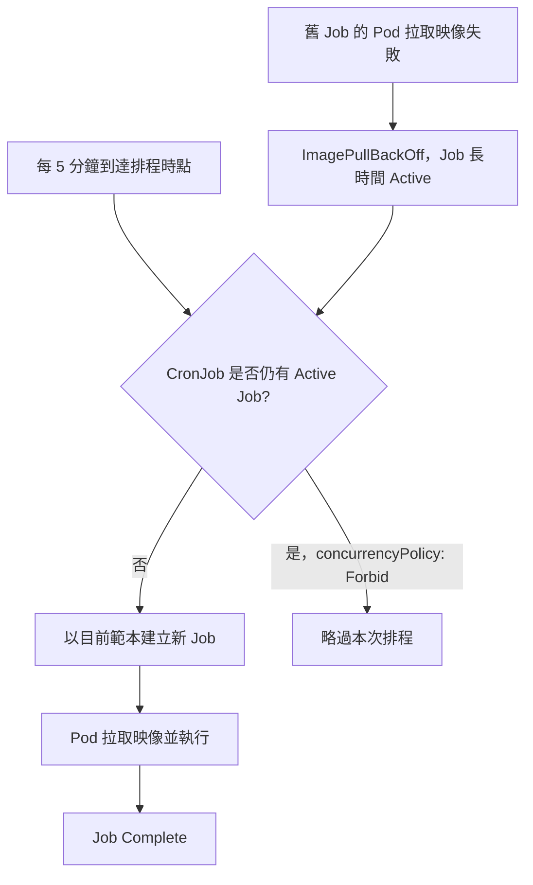

# QA Regular Purchase `notify-queue-retry-job` 排程卡住調查與處理

> 調查日期：2026-10-29（台北時間，UTC+8）  
> 範圍：twqa、hkqa、myqa 的 `qa-regular-purchase-service` 相關 namespace  
> 事件狀態：**已恢復**。2026-10-29 16:25 三個環境均由 CronJob 自動建立 Job 並成功完成；本次調查只讀取資料，沒有執行刪除或修改。

## 一、結論與定位

`notify-queue-retry-job` 是定期購通知 Queue 首送與重試的排程工作。三個 QA 環境的 CronJob 都設為 `*/5 * * * *`、`suspend: false`。排程未能持續執行的直接原因，是先前建立的 Job 長時間維持 Active，而 CronJob 設了 `concurrencyPolicy: Forbid`，因此控制器略過後續每五分鐘的執行機會。

舊 Job 的 Pod 進入 `ImagePullBackOff`。Pod 事件明確記錄 `authorization failed: no basic auth credentials`，舊 Job 使用 `91app-build-site` image pull secret 和 2026-10-10 的舊映像。調查時 CronJob 範本已更新為 `91app-build-site-dev` 與 2026-10-29 的新映像，但更新範本不會修改既有 Job。使用新範本建立的 Job 已成功，支持「舊 Job 殘留造成排程阻塞」的判斷。



## 二、事件證據

| 環境 | Kubernetes context | Namespace | 當時 CronJob 指向的 Active Job | 該次排程時間（台北） | Pod 狀態 |
|---|---|---|---|---|---|
| twqa | `eks-ap-northeast-1-tw-91dev-tw-v2` | `qa-regular-purchase-service` | `notify-queue-retry-job-29882520` | 10/26 02:00 | `ImagePullBackOff` |
| hkqa | `eks-ap-southeast-1-hk-my-91dev-tw-v2` | `hk-qa-regular-purchase-service` | `notify-queue-retry-job-29886840` | 10/29 02:00 | `ImagePullBackOff` |
| myqa | `eks-ap-southeast-1-hk-my-91dev-tw-v2` | `my-qa-regular-purchase-service` | `notify-queue-retry-job-29884210` | 10/27 06:10 | `ImagePullBackOff` |

三個 CronJob 的 `describe` 均出現 `JobAlreadyActive`，訊息為 `Not starting job because prior execution is running and concurrency policy is Forbid`。HK/MY 另有 `TooManyMissedTimes`；這是多次排程被錯過後的結果，不能單憑該事件認定叢集時鐘異常。Pod 事件的映像拉取失敗訊息如下：

```text
Failed to pull image ... : pull access denied, repository does not exist or may require authorization:
authorization failed: no basic auth credentials
```

舊 Job 的 Pod 範本使用：

```text
image: docker-dev.build.91app.io/91app/nine1-regularpurchase-v2-create-task:vLATEST-p-7c2be9b0-dev-b20261010-0122
imagePullSecrets: 91app-build-site
```

調查時 CronJob 的現行範本使用：

```text
image: docker-dev.build.91app.io/91app/nine1-regularpurchase-v2-create-task:vLATEST-p-9c1c0217-dev-b20261029-0647
imagePullSecrets: 91app-build-site-dev
```

2026-10-29 15:16～15:21（台北時間）以新範本建立的 Job 在三個環境均成功完成，但那時 CronJob 的 `lastScheduleTime` 仍停留在上表時間。因此，當時的 `lastSuccessfulTime` 更新只能證明新 Job 可以執行，**不能證明五分鐘自動排程已恢復**。

### 其他舊 Job

twqa 另有 `notify-queue-retry-job-1793256241585`，調查時仍為 Active，Pod 同樣是 `ImagePullBackOff`，且使用舊映像與 `91app-build-site`。先前列出的 `29876045`（TW）、`29884825`（HK）、`29881075`（MY）雖在 Job 清單摘要中顯示 Active，但讀取完整 Job YAML 後其條件實際為 `Failed`、`failed: 7`；它們不是當時 CronJob `status.active` 指向的主要阻塞 Job。處理時應以完整 Job 狀態及 CronJob `status.active` 為準，不能只看摘要欄位。

## 三、根因邊界

已確認：**舊 Job 無法取得映像拉取認證 → Pod 進入 `ImagePullBackOff` → Job 保持 Active → `Forbid` 略過後續排程**。

尚未確認 `91app-build-site` 是不存在、內容過期、Registry 權限不足，還是映像本身不可用。調查帳號對 Secret 的 `get` 權限被 RBAC 拒絕，因此沒有讀取 Secret 內容，也不能把其中一種情況寫成已證實的根因。現行範本使用 `91app-build-site-dev` 且新 Job 已成功，表示現行配置具備可執行的路徑。

## 四、恢復情況與處理紀錄

在本次文件撰寫前重新查詢，三個 CronJob 的 `status.active` 均已清空，舊 Job 也不在 Job 清單；`describe cronjob` 顯示控制器恢復 `SuccessfulCreate`。2026-10-29 16:15、16:20、16:25（台北時間）三個環境均有對應的自動建立 Job，最新的 `29887705` 均為 `Completed`；16:25 的 `lastScheduleTime` 與 `lastSuccessfulTime` 也一致更新。這比單次手動 Job 成功更能證明五分鐘排程已恢復。

本次調查沒有執行刪除或修改。Kubernetes 事件顯示舊 Active Job 消失後控制器重新建立排程 Job，但**無法僅憑這些資料判定由誰、用什麼指令或流程清除了舊 Job**。若需追溯操作者與實際變更時間，應查 Kubernetes audit log 或部署／操作紀錄。

## 五、下次發生時的處理方式

### 1. 先確認當下狀態

以下以 twqa 為例；HK/MY 請替換下表 context 與 namespace：

```powershell
kubectl --context eks-ap-northeast-1-tw-91dev-tw-v2 -n qa-regular-purchase-service get cronjob notify-queue-retry-job -o yaml
kubectl --context eks-ap-northeast-1-tw-91dev-tw-v2 -n qa-regular-purchase-service describe cronjob notify-queue-retry-job
kubectl --context eks-ap-northeast-1-tw-91dev-tw-v2 -n qa-regular-purchase-service get jobs,pods -l app.kubernetes.io/instance=notify-queue-retry-job -o wide
```

檢查 `spec.schedule`、`spec.suspend`、`spec.concurrencyPolicy`、`status.active`、`status.lastScheduleTime`。若有 Active Job，先確認其 Pod 的 `describe` 事件與 Job 完整條件；確認它確實無法完成後，才處理該 Job。

### 2. 若同類故障重現，清理當時仍卡住的舊 Job

**下列名稱是 2026-10-29 調查當時的歷史值，目前已不存在；不要直接照抄執行。** 這份清單用來說明當時的處理範圍：

| 環境 | 當時應清理的 Active Job | 原因 |
|---|---|---|
| twqa | `notify-queue-retry-job-29882520` | CronJob `status.active` 指向，Pod 拉取失敗 |
| twqa | `notify-queue-retry-job-1793256241585` | 額外殘留的 Active Job，Pod 也在 `ImagePullBackOff` |
| hkqa | `notify-queue-retry-job-29886840` | CronJob `status.active` 指向，Pod 拉取失敗 |
| myqa | `notify-queue-retry-job-29884210` | CronJob `status.active` 指向，Pod 拉取失敗 |

再次發生時，應根據**當下**的 CronJob `status.active`、Job 條件和 Pod 事件，決定實際刪除對象。只刪無法完成的舊 Job，不刪 CronJob，也不刪已成功的新 Job。清理後等待下一個五分鐘時點，確認自動產生的 Job 使用現行映像、成功完成，且 `lastScheduleTime` 持續向前更新。

### 3. 驗證標準

| 檢查項目 | 通過條件 |
|---|---|
| CronJob 狀態 | `suspend: false`，沒有長時間停留的 `status.active` |
| 排程連續性 | 連續至少三個五分鐘時點都建立新 Job |
| Job 結果 | 新 Job 為 `Complete`，Pod 沒有 `ErrImagePull`／`ImagePullBackOff` |
| 範本 | 新 Job 使用預期映像與 `91app-build-site-dev` |
| 控制器事件 | 不再新增 `JobAlreadyActive`；舊事件可能仍留在事件清單中 |

## 六、避免再次長時間卡住

1. 為此類短時 CronJob 評估 `activeDeadlineSeconds`，讓無法啟動或無法完成的 Job 有明確終止期限。期限要依正常執行時間及偶發延遲決定；這次成功 Job 約 7～13 秒，不能只憑單次樣本直接定值。
2. 監控 CronJob 的 `lastScheduleTime` 是否超過預期、Job Active 時長、Pod 的 `ImagePullBackOff` 與 `JobAlreadyActive` 事件，及早發現停止排程。
3. 部署更新映像與 image pull secret 後，檢查是否仍有由舊範本建立、持續 Active 的 Job。更新 CronJob 範本本身不會修復既有 Job。
4. 保留 `Forbid` 的防重疊意圖；若改為允許並行，應先確認通知重試工作的重複執行語意與下游承載能力。

## 七、資料來源與限制

- 現場查詢：Kubernetes `get/describe` CronJob、Job、Pod 與事件，查詢時間為 2026-10-29（台北時間）。
- 版本庫設定：`C:\91APP\regular\worker\cronjob\nine1.regularpurchase.v2.cronjob\charts\notify-queue-retry-job\values-tw-qa.yaml`、`values-hk-qa.yaml`、`values-my-qa.yaml`。三份設定均為 `*/5 * * * *`、`Forbid`、`suspend: false`。
- 未讀取 Registry 或 Secret 內容；Secret 查詢遭 RBAC 拒絕。未查 audit log，因此沒有操作者歸因。
- 本文件聚焦 Kubernetes 排程與映像拉取；未深入驗證通知 Queue 業務資料是否有積壓，以及漏掉的執行週期是否需要補處理。
